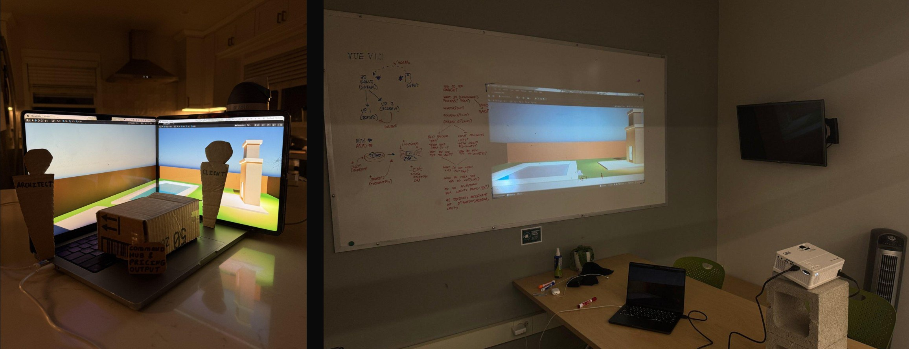
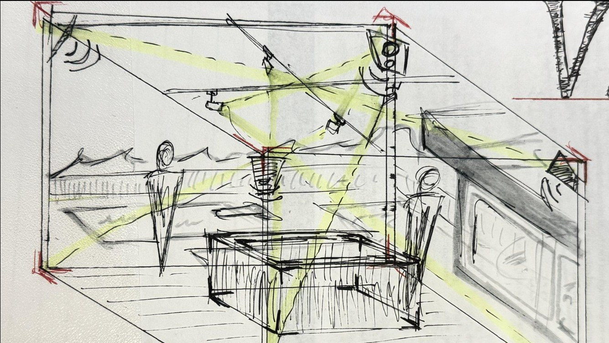

# Vue

**A live design session where homeowners build their yard with the designer.** Vue puts a landscape design on the walls around the client and lets them change it in the room. The goal is for the price to move as they decide.

Working prototype · entrepreneurship course project, 2026 · with Natalie Elliott-Cisneros

> This is a project overview. The source is private.

## The problem

Homeowners commit six figures to a yard they can't picture. They see a 2D plan and a few renders, and the cost of each change arrives later, so decisions stall and the result can disappoint.

## What we heard

We interviewed 9 homeowners and 2 residential landscape designers about their last real projects, without pitching the idea, then grouped the findings with the K-J method.

- **7 of 9** homeowners hit a real gap between what they pictured and what got built
- **6 of 9** found their firm through someone they knew, so an unhappy client can cost a referral too
- **The top need was participation.** People want to see, compare and revise before they commit

That changed the goal. We set out to help firms close more jobs, and added client satisfaction.

## What works today

| | |
|---|---|
| **Built** | An Unreal Engine backyard, shown across two screens as one continuous view |
| **Built** | Changes made from a phone, by text or voice |
| **Built** | A tabletop version and a projected, wall-scale version |
| **Today** | About 90 seconds per change |
| **Target** | Under 10 seconds per change |
| **Next** | Wraparound at life scale, real supplier materials, and testing live pricing |

*Room sketch, illustrative. The wraparound room isn't built yet.*

## What we still need to prove

1. Will designers who are set in their process run a session, then book a second?
2. How close can a live ballpark get to the firm's real quote? Our target is within 15%.
3. Will clients come to a separate space, or does Vue need to go to them?

## My role

I built the Unreal prototype using AI coding tools. Natalie and I worked on the research and concept together.

---
© 2026 Alexander Tarica and Natalie Elliott-Cisneros. All rights reserved.
